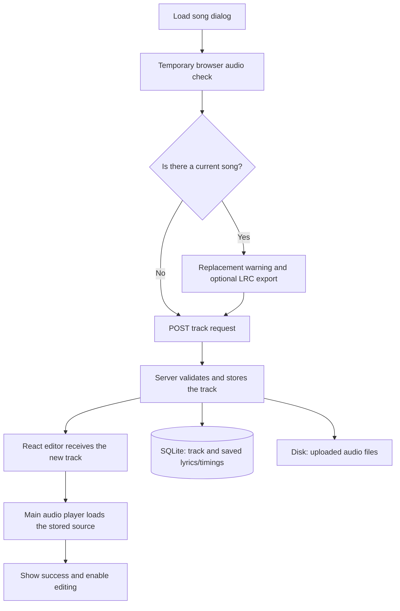

# Load Song: an intern's guide to the implementation

This note explains what we built, how the parts work together, why we made the main decisions, and what we learned during review.

## 1. What we were trying to solve

The editor could already play a demo song, edit lyrics, place lyrics on a timeline, save timings, and export an LRC file. However, the **Load song** button was disabled. The API could read the demo and save its alignment, but it could not create a new track.

The goal was to let someone bring their own audio, either from their device or from a direct audio URL.
n
The finished flow lets the user:

1. Choose a file or enter a URL.
2. Check that the browser can load the audio.
3. Export their existing timed lyrics before replacing a song, if they want to.
4. Store the new song and load it into the player.
5. Start with an empty lyric sheet and add their own lyrics.
6. Get clear guidance and useful errors throughout the process.

We delivered this in three phases, with approval between phases: API and storage, import UI and playback, then empty states and final checks. We later reviewed the code and fixed three additional bugs.

## 2. A few terms used in this note

| Term        | Simple meaning                                                                      |
| ----------- | ----------------------------------------------------------------------------------- |
| Track       | The song record: its title, artist, audio location, and duration.                   |
| Metadata    | Information about the audio, such as its title and length.                          |
| Lyric line  | One piece of lyric text with its own ID.                                            |
| Segment     | A lyric line's start and end times on the timeline.                                 |
| Alignment   | The saved timing information for a lyric sheet.                                     |
| API         | The server endpoints the browser calls to read or store data.                       |
| Transaction | A group of database changes that either all succeed or all roll back.               |
| Streaming   | Moving data in small pieces instead of holding the whole file in memory.            |
| Object URL  | A temporary browser address for a selected local file. It is not permanent storage. |
| LRC         | A text file containing lyrics with timestamps. It does not contain the audio.       |

## 3. The most important product decision: one current song

We chose to keep **one current song**, rather than build a song library.

- Refreshing the page restores the current song from the server.
- Loading another song replaces the previous track, lyric sheet, and saved alignment.
- The previous uploaded audio is removed after a successful replacement, unless the new track still uses that same file.
- Loading a new song starts with `lines: []`, `alignment: null`, and `version: 0`.

This is why the replacement warning appears even when the current song has already been saved. Saving protects the current work across refreshes; it does not add the song to a permanent library.

**Why this choice:** it gives the user persistence without adding a library screen, track selection, or management of multiple projects.

**Tradeoff:** users must export work they want to keep before replacing a song. The replacement cannot be undone through the editor's Undo button.

## 4. How the main parts fit together



For a device file, the server stores a copy of the audio on disk. For an external URL, it stores the link, and the browser plays audio from that host. The server does not download external URL sources.

### Where to look in the code

| Area                | Main files                                 | Responsibility                                                                                   |
| ------------------- | ------------------------------------------ | ------------------------------------------------------------------------------------------------ |
| Import UI           | `apps/web/src/editor/LoadSongDialog.tsx`   | File/URL selection, warning, optional export, submission, and inline feedback.                   |
| Browser audio check | `apps/web/src/utils/probeAudio.ts`         | Check that the selected source can load and has a usable duration.                               |
| Editor state        | `apps/web/src/context/EditorContext.tsx`   | Track data, import progress, editing locks, selection, history, and save requests.               |
| Main player         | `apps/web/src/components/AudioPlayer.tsx`  | Confirm player readiness and show playback errors or retry.                                      |
| Playback state      | `apps/web/src/context/PlaybackContext.tsx` | Playback position, readiness, and controls.                                                      |
| Track API           | `apps/api/src/routes/track.js`             | Read/create a track, validate metadata, and arrange file cleanup.                                |
| File handling       | `apps/api/src/uploads.js`                  | Parse multipart uploads, stream to disk, validate basic file headers, and remove unused uploads. |
| Database operations | `apps/api/src/store.js`                    | Replace the current track and save alignment versions.                                           |
| Audio serving       | `apps/api/src/static.js`                   | Serve stored audio, including requests for a particular section of a file.                       |
| Empty-state UI      | `apps/web/src/editor/TrackEmptyState.tsx`  | Shared no-song guidance for Lyrics and Timeline.                                                 |

## 5. Device files and URLs take different storage paths

### Device file

The browser checks the selected file using a temporary object URL. If it can load, the browser sends the file and its duration using `FormData`.

The server uses **Busboy**, a multipart parser, to read the upload. It writes the audio to disk in chunks, using a generated filename rather than the user's filename.

By default, uploaded files live in `apps/api/data/uploads/`. The `UPLOAD_DIR` environment variable can change this location. SQLite stores the audio URL and metadata; it does not store the audio bytes.

**Why:** streaming avoids creating a second whole-file copy in JavaScript memory. Generated filenames avoid collisions and prevent a supplied filename from controlling where the server writes the file.

### Direct audio URL

The browser checks the URL, then sends a small JSON request. The server stores the URL without fetching its contents.

**Why:** this avoids server download time, duplicate storage, and the extra security work involved in making the server fetch arbitrary addresses.

**Tradeoff:** the song depends on the remote host. The link can expire, become unavailable, or stop allowing playback. A streaming-service webpage link is not necessarily an audio file URL.

## 6. The API contract

Track reads and writes use the existing bearer-token authentication.

| Endpoint                      | Purpose                                                    |
| ----------------------------- | ---------------------------------------------------------- |
| `GET /api/v1/track`           | Read the current track, lyrics, and alignment.             |
| `POST /api/v1/track`          | Create the new current track and replace the previous one. |
| `PUT /api/v1/track/alignment` | Save lyrics and timing segments for the current track.     |

### Create a track from a URL

```json
{
  "audio_url": "https://example.com/song.mp3",
  "duration_seconds": 125.4,
  "title": "My song"
}
```

`title` is optional. Without one, the server derives a title from the file or URL path, then falls back to **Untitled song**. An unknown artist is an empty string.

### Create a track from a device file

Send multipart form data containing:

- `file`: the audio file.
- `duration_seconds`: the duration found by the browser.
- `title`: optional text.

The frontend API wrapper lets the browser set the multipart `Content-Type`. This matters because the browser must add a **boundary**, a marker that separates the file and text fields. Manually setting only `multipart/form-data` would leave that marker out.

Both creation paths return `201` with the normal track payload, including its new ID and empty lyrics/alignment state.

### Save an alignment

```json
{
  "track_id": "7",
  "version": 0,
  "lines": [],
  "segments": []
}
```

Two fields protect against different stale-save problems:

- **`track_id` answers “which song?”** If another session loaded a different song, the API rejects a save for the old song with `409 track_conflict`.
- **`version` answers “which saved revision?”** If another session saved a newer alignment for the same song, the API rejects the outdated version with `409 version_conflict`.

Empty lyric arrays are now valid. A freshly imported song genuinely has no lyrics yet.

These checks apply to alignment saves. Track creation does not currently require an expected track ID or version before replacing the current song.

## 7. Why replacement happens in a particular order

The server follows this sequence:

1. Receive and validate the new input. For a file, finish writing the staged upload.
2. Begin a SQLite transaction.
3. Insert the new track.
4. Delete the previous database track and its related lyric/alignment records.
5. Commit the transaction.
6. Remove the previous uploaded audio if the new track no longer uses it.

The new row is inserted **before** deleting the old row so it gets a different track ID. That identity change lets stale-save checks and playback reset logic distinguish the songs.

**Why the transaction matters:** if a database change fails, the database rolls back to the previous track instead of leaving half a replacement.

**Why file deletion comes last:** deleting the old audio first would make rollback useless—the old database record could return, but its audio would already be missing.

Database transactions do not undo disk operations. The code therefore removes newly staged files when an upload or replacement fails before commit. A forced process exit can still leave an unused file on disk; automatic crash-time cleanup was not added.

The bundled demo audio is not deleted by upload cleanup.

## 8. “Stored” and “ready to play” are separate steps

An API success means the server stored the track. It does not prove that the main player can load it.

We therefore check audio twice for different reasons:

1. **Before storage:** a temporary audio element checks the chosen source and reads its duration.
2. **After storage:** the main player loads the returned audio URL. Its `canplay` event confirms that playback can begin.

Only after the second step do we show:

> Song loaded, please add lyrics to the lyrics sheet.

The check does not guarantee that every later second of a remote stream will remain available. Later playback errors still need handling.

| Step                          | Time limit |
| ----------------------------- | ---------- |
| Initial browser check         | 30 seconds |
| Persistence request           | 2 minutes  |
| Initial main-player readiness | 30 seconds |

## 9. React state and component lifetime decisions

### Keep editor data in the existing reducer

We extended the existing editor state instead of adding another state-management library. It now tracks whether the import dialog is open, whether an import is running, whether player readiness is pending, and any import error.

The main workspace states are `loading`, `empty`, `ready`, and `error`.

**Why:** the track, selection, undo history, and save status already live here. Keeping import transitions beside them makes resetting or locking the editor consistent.

### Lock both the controls and the state updates

During persistence and player readiness, editing controls are disabled and the reducer rejects unrelated editing actions. Repeated submissions are also blocked.

**Why:** disabling a button alone does not cover keyboard shortcuts or events that were already queued. The reducer provides the second guard.

### Reset the playback session for a new track

The playback session uses the track ID and audio URL as its React key. Changing that identity recreates the session and its editor children. This resets playback to paused at zero and clears the previous local lyric draft. The reducer resets selection and undo/redo history.

Saving the same track keeps the same identity, so an ordinary alignment save does not restart playback.

### Keep the import dialog outside that reset

The import dialog sits outside the keyed playback session, while still reading the editor context.

**Why:** replacing the track remounts the player/editor subtree. If the dialog lived inside that subtree, it would disappear before the new player could report readiness or a playback error.

## 10. Replacement warning and export behavior

After a candidate source passes the browser check, an existing track triggers the replacement warning.

The user can:

- **Continue:** replace the track without exporting.
- **Export and continue:** start an LRC download of current timed lyrics, then replace the track.
- **Close with X or Escape:** cancel and keep working.

Export uses the current edits, including unsaved changes. It excludes audio and untimed lyric lines. If nothing is timed, Export and continue is disabled and the dialog explains why.

The browser can confirm that a download was started; it cannot confirm that the user saved the file successfully.

Checking audio can be cancelled. Once submission starts, dismissal is disabled until the request or readiness check settles. This avoids presenting cancellation as a guarantee that an already-running server replacement was stopped.

The dialog also keeps keyboard focus inside it, prevents editor shortcuts from acting behind it, and returns focus to Load song when it closes.

## 11. Errors must explain what actually happened

| Situation                                | What the user should understand                                                                                                           |
| ---------------------------------------- | ----------------------------------------------------------------------------------------------------------------------------------------- |
| Invalid or unplayable source             | Choose another file or check the direct audio link. Nothing has been replaced.                                                            |
| Upload or database failure before commit | The previous track remains; retry is available.                                                                                           |
| Connection lost or request timed out     | The browser cannot confirm the server outcome. The current edits remain in the browser, but a reload may be needed to check server state. |
| Server committed, but player failed      | The new song was stored. The previous song was already replaced. Retry loading or choose another source.                                  |
| Later playback failure                   | Retry playback or load another source.                                                                                                    |

Import and playback failures use inline messages and Sonner toasts. The inline message remains available after the toast disappears.

The distinction between a pre-commit failure and a post-commit playback failure is important. We must not promise that the old song still exists after a successful database replacement.

## 12. Empty states are part of the feature

There are three different situations to explain:

| Situation                   | Guidance                                                                                                    |
| --------------------------- | ----------------------------------------------------------------------------------------------------------- |
| No song                     | Both Lyrics and Timeline explain how to use Load song. Editing and playback-dependent actions are disabled. |
| Song loaded, no lyrics      | Explain how to enter lyrics in the lyric sheet and choose Add all lines.                                    |
| Lyrics exist, no placements | Explain dragging lyrics onto the timeline or using Stamp current time.                                      |

Only `404` with the API error code `no_current_track` becomes the `empty` state. An unrelated 404, a network failure, or a server error still shows error feedback and Retry.

**Why:** “there is no song yet” is a normal starting point. “We could not read the song” is a failure. Treating both as empty would hide real problems.

The timeline does not render its ruler and drop surface without a song. The shared guidance component adds no requests or playback subscriptions.

## 13. Performance decisions

- **Stream uploads to disk.** The API does not build a whole-song buffer in memory. Disk backpressure means incoming data slows down when the disk writer cannot keep up.
- **Limit uploads to 100 MiB.** Also limit multipart fields, part counts, and field sizes.
- **Use native audio checks.** We do not convert files to base64 or decode a full audio buffer in JavaScript just to import a song.
- **Release temporary resources.** Stop the probe and revoke its object URL on completion or cancellation.
- **Keep playback updates separate.** The import dialog does not subscribe to continuously changing playback position.
- **Serve byte ranges.** The player can request a section of uploaded audio for seeking instead of always fetching from the beginning.
- **Avoid unnecessary new tools.** We reused the reducer, playback store, native dialogs, buttons, LRC helper, and toast system. Busboy was added on the server for multipart parsing; no frontend dependency was added for import.

These choices reduce avoidable work. We did not claim a measured memory or latency benchmark.

## 14. What code review found, and how we fixed it

### Bug 1: an optional title caused a valid upload to fail

The API documented three multipart parts: file, duration, and optional title. Busboy's overall part limit was set to three, but its `partsLimit` event fires when that threshold is reached, including the final boundary.

That meant a valid three-part request was treated as too large.

**Fix:** use an overall threshold of four while retaining the one-file/two-field limits. Extra fields, duplicate metadata, and additional files are still rejected.

**Lesson:** check the library's actual boundary behavior. A test for an oversized request does not prove that the largest valid request succeeds.

### Bug 2: accented filenames produced corrupted titles

The browser sent a UTF-8 filename such as `Cântec.wav`. Busboy used its default Latin-1 interpretation for filename parameters, producing `Cântec.wav`.

**Fix:** explicitly set `defParamCharset: 'utf8'` and test accented text, Japanese characters, and an emoji. Also check that an explicit title still takes precedence.

**Lesson:** text encoding must agree at both ends. Unicode lyric support alone does not guarantee Unicode filename support.

### Bug 3: reusing the current upload's URL deleted the audio

Suppose the current song uses `/api/audio/uploads/example.wav`, and the user enters its absolute URL as the new source. The browser can check it successfully. Previously, replacement stored the URL and then deleted the old file—even though the replacement still referenced it.

**Fix:** recognize the current upload when the URL belongs to the API origin or the browser origin behind the development proxy. Keep its canonical relative URL, preserve the existing title unless overridden, and skip deleting the reused file. When a genuinely different song replaces it later, normal cleanup still removes it.

“Origin” means scheme, host, and port together—for example, `http://localhost:5173`. Checking the origin matters: an unrelated remote host with the same path is still a remote source.

**Lesson:** before removing an old resource, check whether the new state still uses it. Also preserve enough ownership information for future cleanup.

## 15. Testing and verification

Tests use temporary databases and upload folders, or mocked browser responses. The real-API import test also uses an isolated server. They do not replace the user's working song.

The checks cover:

- File and URL imports, including persistence after refresh.
- Empty lyrics and alignment on a new track.
- Replacement warning, cancellation, keyboard focus, and export.
- Selection, history, draft, and playback resets.
- Invalid sources, malformed uploads, size limits, interrupted uploads, and storage failures.
- Readiness timeouts, duplicate submissions, and playback retry.
- Track identity and alignment-version conflicts.
- Desktop/mobile empty states and recovery from real errors.
- Optional titles, UTF-8 filenames, reused upload URLs, and later cleanup.

At the end of Phase 3, 123 browser tests passed, along with typecheck, lint, and production build. Two older tests expecting the commented-out separate Seek playback slider were excluded and documented.

After the review fixes, the relevant rerun passed **17 API tests and 27 import/empty-state browser tests**, plus lint and whitespace checks. This was a focused rerun, not another full-suite run.

One test adjustment also preserved the dialog's newer Audio URL default: file-import tests now explicitly select Device file rather than assuming it is already selected.

Useful commands:

```sh
pnpm test:api
pnpm exec playwright test e2e/load-song.spec.ts e2e/empty-state.spec.ts
pnpm typecheck
pnpm lint
pnpm build
```

## 16. Things to remember when extending this work

- This is still one current workspace, not a song library or complete project backup system.
- LRC export cannot restore audio, untimed lyrics, or the entire editor project.
- External audio links can expire or stop working.
- Server header checks do not prove that every byte of a file is decodable. The browser performs playback validation, and the client supplies duration metadata.
- Upload limits do not provide a total disk quota or crash-time orphan collection.
- The existing bearer-token model remains in place. This change did not introduce separate user accounts or per-user track ownership.
- Audio asset requests remain unauthenticated because the native player does not attach the API wrapper's bearer header.
- Startup still seeds the demo by default when the database is empty. `SEED_ON_START=false` allows a genuinely empty startup; an existing imported song is preserved.

For the shorter decision history, see [Implementation decisions](../decisions.md).
